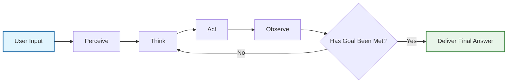

# AI Agents: Practical Learning Repository

[](LICENSE)
[](CONTRIBUTING.md)
[](README.md)
[](https://github.com/Flynntaggart26/ai-agents-learning-repo/releases)
[](https://github.com/Flynntaggart26/ai-agents-learning-repo/commits/main)
[](https://github.com/Flynntaggart26/ai-agents-learning-repo/issues)
[](https://github.com/Flynntaggart26/ai-agents-learning-repo/pulls)


## What This Repository Is About

This repository is a comprehensive guide to AI agents, covering their architecture, capabilities, tools, and best practices. It answers questions like:

- **What is an AI agent?** (How is it different from a simple chatbot or assistant?)
- **How does an agent work?** (Perceive → Think → Act → Observe loop)
- **How do we add tools to agents?** (Web search, calculators, email, databases, etc.)
- **How do we build an agent?** (Step-by-step guide)
- **How do we evaluate and improve agent quality?** (Metrics, testing strategies)
- **How do we safely deploy agents in production?** (Scaling, observability, security)

### Agent Loop




## Learning Path (Roadmap)

Follow this roadmap to explore the documentation in sequence:

| Step | File | What You Will Learn |
|------|-------|-------------------|
| 1 | [`docs/01-introduction-to-ai-agents.md`](docs/01-introduction-to-ai-agents.md) | What is an AI agent, differences from chatbots and assistants, core components
| 2 | [`docs/02-how-agents-work.md`](docs/02-how-agents-work.md) | Agent loop: Perceive → Think → Act → Observe
| 3 | [`docs/03-agent-architecture.md`](docs/03-agent-architecture.md) | ReAct, planning, reflection, and multi-agent architectures
| 4 | [`docs/04-core-capabilities.md`](docs/04-core-capabilities.md) | Reasoning, planning, reflection, and self-correction
| 5 | [`docs/05-tools-and-integrations.md`](docs/05-tools-and-integrations.md) | Adding tools to agents, security rules, popular frameworks
| 6 | [`docs/06-memory-systems.md`](docs/06-memory-systems.md) | Short-term, long-term, subjective, and semantic memory; RAG
| 7 | [`docs/07-multi-agent-systems.md`](docs/07-multi-agent-systems.md) | Multi-agent systems: pipeline, debate, orchestrator patterns
| 8 | [`docs/08-building-an-agent.md`](docs/08-building-an-agent.md) | Building your first agent from scratch (step-by-step guide)
| 9 | [`docs/09-evaluation-and-testing.md`](docs/09-evaluation-and-testing.md) | Measuring agent quality, evaluation methods, testing strategies
| 10 | [`docs/10-deployment-and-observability.md`](docs/10-deployment-and-observability.md) | Production deployment, observability, cost control, security
| 11 | [`docs/11-best-practices-and-security.md`](docs/11-best-practices-and-security.md) | Best practices, injection protection, human-in-the-loop validation

---

## Quick Start

Get started with your first agent in three steps:

### 1. Clone the Repository

```bash
git clone https://github.com/Flynntaggart26/ai-agents-learning-repo.git
cd ai-agents-learning-repo
```

### 2. Explore Example Code

The repository includes working examples in Python and JavaScript:

#### Python: Basic ReAct Agent

```python
from openai import OpenAI

client = OpenAI()

def run_agent(user_message):
    messages = [
        {"role": "system", "content": "You are a helpful agent. Use tools when needed."},
        {"role": "user", "content": user_message}
    ]
    
    for _ in range(10):  # Maximum 10 steps
        response = client.chat.completions.create(
            model="gpt-4o-mini",
            messages=messages,
            tools=[...]  # Define your tools here
        )
        message = response.choices[0].message
        messages.append(message)
        
        if not message.tool_calls:
            return message.content  # Final answer
        
        for tool_call in message.tool_calls:
            result = execute_tool(tool_call)
            messages.append({
                "role": "tool",
                "tool_call_id": tool_call.id,
                "content": str(result)
            })
    
    return "Maximum steps reached."

# Full working example: [`examples/python/basic_agent/agent.py`](examples/python/basic_agent/agent.py)
```

#### JavaScript: Basic Agent

```javascript
const { OpenAI } = require("openai");
const client = new OpenAI({ apiKey: process.env.OPENAI_API_KEY });

async function runAgent(userMessage) {
  const messages = [
    { role: "system", content: "You are a helpful agent." },
    { role: "user", content: userMessage }
  ];
  
  for (let step = 0; step < 10; step++) {
    const response = await client.chat.completions.create({
      model: "gpt-4o-mini",
      messages,
      tools: [...]
    });
    const message = response.choices[0].message;
    messages.push(message);
    
    if (!message.tool_calls || message.tool_calls.length === 0) {
      return message.content;
    }
    // Execute tool calls and continue...
  }
  return "Maximum steps reached.";
}

# Full working example: [`examples/javascript/basic_agent.js`](examples/javascript/basic_agent.js)
```

### 3. Run the Examples

Run the provided examples to see agents in action:

1. **Python**: Execute the script directly.
2. **JavaScript**: Use Node.js to run the agent loop.

```bash
# Run Python example
cd examples/python/basic_agent
pip install -r requirements.txt
export OPENAI_API_KEY="sk-..."
python agent.py

# Run JavaScript example
cd examples/javascript
npm install openai dotenv
export OPENAI_API_KEY="sk-..."
node basic_agent.js
```

> ⚠️ **Important:** Never commit your `OPENAI_API_KEY` to the repository. Use `.gitignore` to exclude `.env` files.

---

## Repository Structure

```mermaid
flowchart TD
    root[ai-agents-learning-repo]
    root --> docs[docs/]
    root --> examples[examples/]
    root --> resources[resources/]
    root --> projects[projects/]
    root --> glossary[glossary.md]
    root --> mkdocs[mkdocs.yml]
    root --> ci[.github/workflows/ci.yml]
    root --> license[LICENSE]
    root --> contributing[CONTRIBUTING.md]
    
    docs --> d1[01-introduction]
    docs --> d2[02-how-agents-work]
    docs --> d3[03-architecture]
    docs --> d4[04-capabilities]
    docs --> d5[05-tools]
    docs --> d6[06-memory]
    docs --> d7[07-multi-agent]
    docs --> d8[08-building]
    docs --> d9[09-evaluation]
    docs --> d10[10-deployment]
    docs --> d11[11-best-practices]
    
    examples --> py[python/]
    examples --> js[javascript/]
    py --> basic[basic_agent/]
    py --> web[web_search_agent/]
    
    style root fill:#f9f,stroke:#333,stroke-width:4px
    style docs fill:#e1f5fe,stroke:#01579b
    style examples fill:#e8f5e9,stroke:#2e7d32
    style resources fill:#fff3e0,stroke:#ef6c00
    style projects fill:#f3e5f5,stroke:#7b1fa2
```



---

## Who Is This For?

This repository is designed for:
- **Developers**: Looking for practical code examples to integrate AI agents into applications.
- **Students**: Learning about LLM-based systems and agent architectures.
- **Tech enthusiasts**: Seeking deep answers to "What is an AI agent?"

**Prerequisites**: Basic programming knowledge (Python or JavaScript) is sufficient. No prior machine learning experience is required.

---

## Contributing

Contributions are welcome! Here’s how you can get involved:

1. **Fork the repository** and clone it locally.
2. **Create a new branch**: `git checkout -b feature-name`
3. **Make your changes** and commit them with a descriptive message: `git commit -m "feat: ..."`
4. **Push your branch**: `git push origin feature-name`
5. **Open a Pull Request** and explain your changes.

For detailed guidelines, see [`CONTRIBUTING.md`](CONTRIBUTING.md).

---

## License

This project is licensed under the [MIT License](LICENSE) — you can freely use, modify, and share it.

---

## Useful Links

- [`resources/free-resources.md`](resources/free-resources.md): Free books, articles, courses, and tools
- [`projects/project-ideas.md`](projects/project-ideas.md): Practical project ideas
- [`glossary.md`](glossary.md): Simple explanations of key terms

---

*Built for learners, kept free and open.*